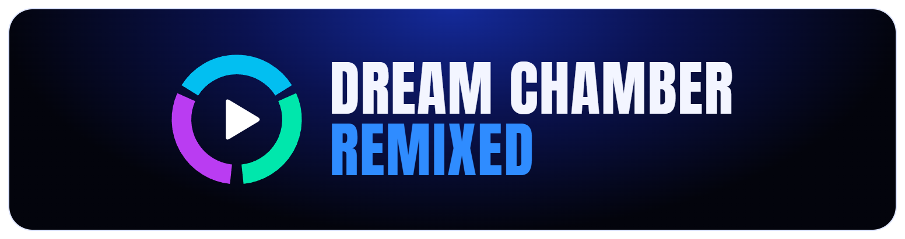
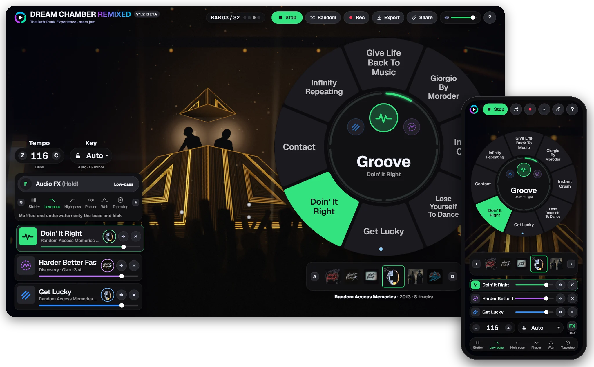

<div align="center">



**Jam with Daft Punk stems in your browser.**<br>
Pick a groove, a lead and an extra from different songs. Every pick lands in tempo and in key.

[](https://dreamchamberremixed.xyz)

[](CHANGELOG.md)
[](LICENSE)


<a href="https://dreamchamberremixed.xyz"></a>

</div>

## What is it?

A jam station inspired by the remix area of **The Daft Punk Experience** in Fortnite, rebuilt
for the web. Fill three layers, **Groove**, **Lead** and **Extra**, with stems from 24 Daft Punk
songs on a radial song wheel. Each stem is time-stretched to one tempo and pitch-shifted to one
key, so any combination you pick stays in sync. Everything runs in the browser.

## Features

- 🎡 **Radial song wheel.** One page per album. The hub switches layers and counts through the
  32-bar loop.
- 🎚️ **Auto-sync.** WSOLA time-stretch to any tempo from 80 to 140 BPM, rendered in parallel
  worker threads. Key lock moves every stem into one key, and a major key is treated as its
  relative minor, so A major mixes with F♯m untouched. Song swaps land on the next bar.
- 🔊 **Even levels, no clipping.** Each stem is loudness-matched (BS.1770). A look-ahead
  true-peak limiter keeps the mix under -1 dBTP.
- 💿 **24 songs, 57 stems** from Homework, Discovery, Human After All, Alive 2007, Random Access
  Memories and the Weeknd collaborations.
- ✨ **Six hold-to-play effects:** Stutter, Low-pass and High-pass sweeps, Phaser, Wah and Tape
  stop. Let go and the mix snaps back in time.
- 🔺 **Live stage.** A neon pyramid concert behind the interface, with the duo bopping in time.
  Every layer you add brings in more of the light show, and the groove's album picks the colours.
- 🔗 **Share, record, export.** A share link stores the whole mix in its URL. You can record the
  jam or export a 32-bar loop as a WAV.
- 📱 **Keyboard, mouse and touch**, with layouts for phones held either way. You can install it
  to your home screen.

## Controls

The keyboard layout follows The Daft Punk Experience on PC.

| Action | Keyboard / mouse |
|---|---|
| Pick a song | Hold the mouse button, drag through the songs and let go (or just click). Or `←` `→` then `Enter` |
| Next layer | `Space`. `1` `2` `3` jump to Groove, Lead or Extra |
| Audio FX | Choose one in the FX strip (or `Q` / `E`), then hold `F` or the FX button |
| Tempo | `Z` / `C`, or the pill buttons |
| Albums | `A` / `D`, or the album tiles |
| Jam mode | **Enter Jam** (top left) or click empty space. This hides the cursor so small mouse flicks steer the wheel. `Tab` exits |
| Play / random mix | `P` / `R` |
| Mute / clear layer | `M` / `Backspace` |

On a phone or tablet, tap or drag on the wheel, and press and hold **FX** for effects.

## Credits

- **[MuscularCrab](https://github.com/MuscularCrab)**: audio engine
- **[Lizardkingrick](https://github.com/lizardkingrick)**: UI, visuals and web app
- **2Liter** ([@the_peoples_yinzer](https://www.instagram.com/the_peoples_yinzer/) on Instagram): contributor

> [!NOTE]
> This is a fan project. It is not affiliated with Daft Punk, Epic Games or Fortnite. The stems
> come from The Daft Punk Experience and remain © Daft Punk and their labels. They are **not**
> included in this repository.

**Humans after all (mostly).** AI tools helped build parts of this project.

## Run it yourself

The code is here, but the audio is not.

**To work on the code with no stems**, you need only [Node.js](https://nodejs.org) 18+. This
streams the audio from the live site and saves nothing to disk:

```bash
node tools/serve-live.mjs     # http://localhost:8138/
```

**With your own copy of the stems on Windows, nothing to install:** double-click **`start.cmd`**. It finds a `Stems` folder next to
the app (or up to three folders above it), starts a local server and opens your browser. The
WAV files play straight from disk.

**With Node.js 18+ and ffmpeg:**

```bash
npm install
npm run stems     # converts the WAV stems to Ogg and writes stems.json
npm run dev       # http://localhost:8137/webapp/
```

[docs/self-hosting.md](docs/self-hosting.md) covers stem file naming, album covers, LAN mode for
phones and publishing behind a reverse proxy.

## Contributing

Bug reports, ideas and pull requests are welcome. Read **[CONTRIBUTING.md](CONTRIBUTING.md)** for
how the project is laid out and how to test a change. To see what's planned, read the
[roadmap](docs/roadmap.md). For changes in each version, read the [changelog](CHANGELOG.md).

Maintainers: deploys and releases are covered in [docs/maintaining.md](docs/maintaining.md).

## License

The code is under the [MIT](LICENSE) license. The audio, album art and the Daft Punk name are not
covered by it (see [Credits](#credits)).
